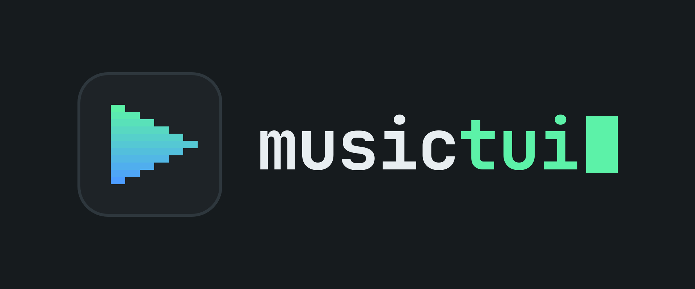
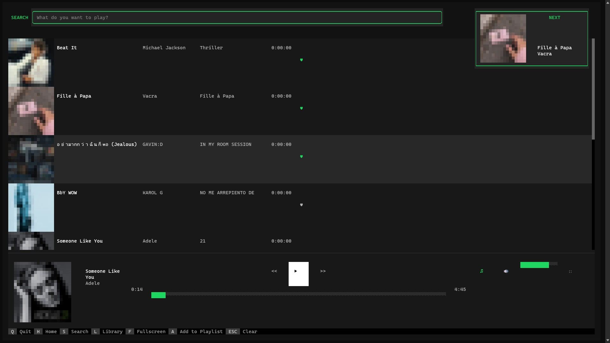
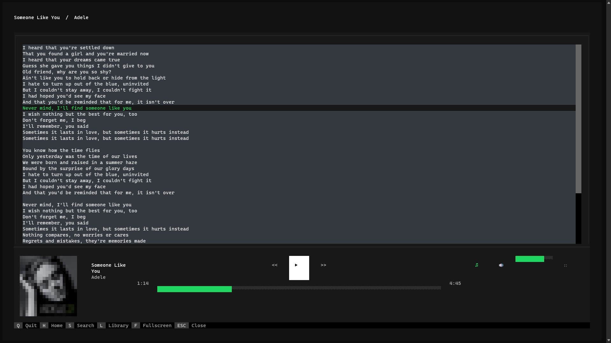
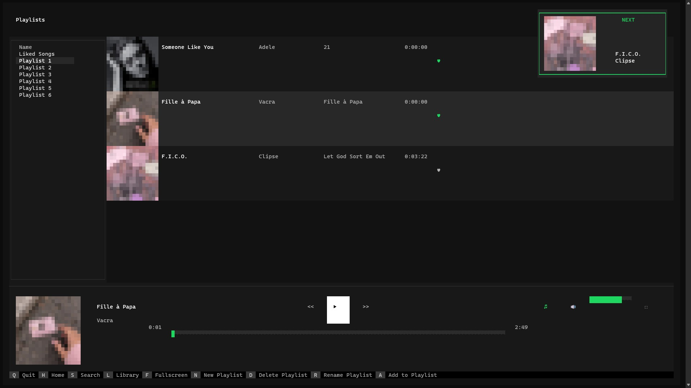
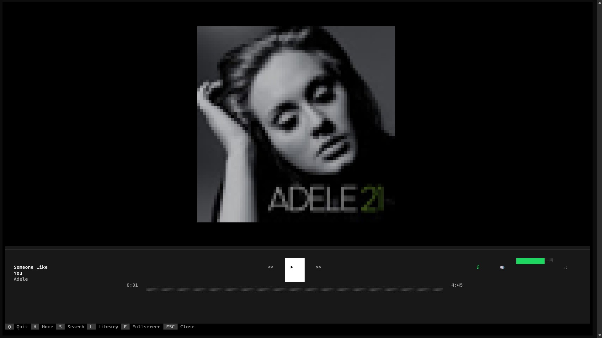

<div align="center">



### A terminal music player that streams, sings along, and shows off its album art

Built with [Textual](https://textual.textualize.io/). Streams from YouTube Music, displays synchronized lyrics, and renders album art directly in your terminal using ANSI half-block characters.

<br>


<br>

[Features](#-features) •
[Screenshots](#-screenshots) •
[Installation](#-installation) •
[Shortcuts](#-keyboard-shortcuts) •
[Architecture](#-architecture) •
[Testing](#-testing)

</div>

---

## ✨ Features

| | Feature | Details |
|:-:|---|---|
| 🎧 | **Real-time playback** | Streams directly from YouTube Music using `ytmusicapi`, with VLC as the audio backend |
| 📜 | **Synchronized lyrics** | Fetches lyrics via YouTube Music and the `syncedlyrics` library, with timestamp-based highlighting as the song plays |
| 🎨 | **Terminal-rendered album art** | Uses NumPy and Pillow to downscale images to ANSI half-block colour characters, rendered in real time |
| 📋 | **Playlist management** | Create playlists (`N`), add the current track to a playlist (`A`), remove tracks (`D`), and delete playlists |
| 🔀 | **Smart queue** | Skip, history-aware back navigation, and repeat modes (`OFF` / `ALL` / `ONE`) |
| 🖥️ | **Fullscreen album art** | Press `F` to view the album art at full terminal resolution |
| ⚡ | **Background workers** | Artwork rendering, stream resolution, and lyrics fetching run in threaded workers with generation-based cancellation to avoid race conditions |

---

## 📸 Screenshots

<table>
  <tr>
    <td align="center" width="50%">
      <b>Home Screen</b><br>
      
    </td>
    <td align="center" width="50%">
      <b>Lyrics Overlay</b><br>
      
    </td>
  </tr>
  <tr>
    <td align="center" width="50%">
      <b>Library</b><br>
      
    </td>
    <td align="center" width="50%">
      <b>Fullscreen Album Art</b><br>
      
    </td>
  </tr>
</table>

---

## 🚀 Installation

### 1. System prerequisites

MusicTUI uses VLC as its audio playback engine. Install the native VLC binaries (plus ffmpeg) first, otherwise audio streaming won't work.

| Platform | Command |
|---|---|
| **Arch Linux** | `sudo pacman -S vlc ffmpeg` |
| **Ubuntu / Debian** | `sudo apt install vlc ffmpeg` |
| **Fedora** | `sudo dnf install vlc ffmpeg` |
| **Windows** | `winget install VideoLAN.VLC Gyan.FFmpeg` (or download VLC from [videolan.org](https://www.videolan.org/vlc/)) |

> [!TIP]
> On Windows, the VLC build must match your Python build (64-bit VLC with 64-bit Python), or the audio backend won't load.

### 2. Install with pipx (recommended)

[pipx](https://pipx.pypa.io/) installs MusicTUI in its own isolated environment and puts the `musictui` command on your PATH.

**Linux**

```bash
# Install pipx (pick your distro)
sudo pacman -S python-pipx      # Arch
sudo apt install pipx           # Ubuntu / Debian
sudo dnf install pipx           # Fedora

pipx ensurepath
```

**Windows** (PowerShell or Command Prompt)

```cmd
py -m pip install --user pipx
py -m pipx ensurepath
```

Restart your terminal after running `ensurepath`, then install and launch MusicTUI (same command on both platforms):

```bash
pipx install musictui-ros
musictui
```

To update later: `pipx upgrade musictui-ros`

### 3. Build from source

Use this if you want to hack on the code or run the test suite.

**Linux**

```bash
# Clone the repository
git clone https://github.com/RosarioLC/musictui.git
cd musictui

# Create and activate a virtual environment
python3 -m venv .venv
source .venv/bin/activate

# Install in development mode
pip install -e ".[dev]"

# Run the app
musictui
```

**Windows** (PowerShell or Command Prompt)

```cmd
:: Clone the repository
git clone https://github.com/RosarioLC/musictui.git
cd musictui

:: Create and activate a virtual environment
python -m venv .venv
.venv\Scripts\activate

:: Install in development mode
pip install -e ".[dev]"

:: Run the app
musictui
```

---

## ⌨️ Keyboard Shortcuts

| Key | Screen | Action |
|:-:|---|---|
| `H` | Any | Go to Home (recommendations) |
| `S` | Any | Go to Search |
| `L` | Any | Go to Library |
| `F` | Any | Toggle fullscreen album art |
| `Q` | Any | Quit |
| `A` | Home / Search | Add currently playing track to a playlist |
| `N` | Library | Create a new playlist |
| `D` | Library / Playlist | Delete playlist / remove track from playlist |
| `↑` `↓` | Results tables | Navigate track list |
| `Enter` | Results tables | Play selected track |

---

## 🏗️ Architecture

<details>
<summary><b>Project structure</b> (click to expand)</summary>

<br>

```
music/
├── main.py                          # Package entry point (musictui CLI command)
├── pyproject.toml                   # Package metadata, dependencies, and CLI entry point
├── config.py                        # Local configuration (API keys, paths)
├── LICENSE                          # MIT License
├── model/
│   ├── track.py                     # Immutable Track dataclass (slots=True, frozen=True)
│   ├── lyric_line.py                # Timed lyric line model
│   ├── play_state.py                # Immutable play state (is_playing, is_paused)
│   ├── repeat_mode.py               # Enum: OFF → ALL → ONE with cycle logic
│   └── playlist.py                  # Playlist with O(1) membership, cursor navigation
├── catalog/
│   ├── ytmusic_source.py            # YouTube Music API client (lazy-loaded)
│   ├── catalog_source.py            # Protocol abstract base for catalog providers
│   ├── downscaler.py                # Image → ANSI half-block renderer (NumPy + Pillow)
│   ├── lyrics_parser.py             # Parses LRC-format synced lyrics timestamps
│   ├── lyrics_provider.py           # File-based lyrics loader
│   ├── stream_resolver.py           # Stream URL resolver (fallback pass-through)
│   └── track_cache.py               # Generic LRU cache + TrackCache (tracks, lyrics, streams)
├── playback/
│   ├── player.py                    # High-level playback controller
│   ├── vlc_backend.py               # VLC media library wrapper (AudioBackend protocol)
│   └── music_queue.py               # Queue with history, repeat, shuffle, add, skip
├── services/
│   ├── catalog_service.py           # Catalog service (search, track resolution, lyrics)
│   ├── library_service.py           # Library service (playlists, liked songs CRUD)
│   └── playback_service.py          # Playback service (play, pause, seek, volume, queue)
├── store/
│   ├── database.py                  # SQLite connection wrapper with FK migrations
│   ├── playlist_store.py            # Playlist persistence + track resolution
│   └── liked_song_store.py          # Liked songs persistence
├── tests/
│   ├── catalog/                     # Lyrics parser, provider, cache, mock catalog
│   ├── models/                      # Track, Playlist, PlayState, RepeatMode
│   ├── playback/                    # MusicQueue, Player (with FakeBackend)
│   └── store/                       # PlaylistStore, LikedSongStore (in-memory SQLite)
└── ui/
    ├── app.py                       # MusicTUI application (screen nav, workers)
    ├── messages.py                  # EventBus + playback event message types
    ├── mixins.py                    # Shared screen mixins (Likeable, PlaylistActionable)
    ├── style.tcss                   # Textual CSS theme (dark, Spotify-inspired)
    ├── screens/
    │   ├── home_screen.py           # Recommendations + infinite scroll
    │   ├── search_screen.py         # Search with deduplication
    │   ├── library_screen.py        # Playlist management (create/delete/add)
    │   ├── playlist_screen.py       # View, play, and manage playlist tracks
    │   ├── lyrics_screen.py         # Synchronized lyrics display
    │   └── fullscreen_screen.py     # Fullscreen album art overlay
    └── widgets/
        ├── search_bar.py            # Search input with label
        ├── search_result.py         # DataTable subclass with artwork + scroll detection
        ├── now_playing_bar.py       # Playback state + progress + volume
        ├── player_controls.py       # Play/pause/next/prev buttons
        ├── queue_panel.py           # Upcoming tracks list
        ├── lyrics_panel.py          # Scrolling lyrics display
        ├── next_track_card.py       # Preview of the next track
        ├── volume_control.py        # Volume slider
        ├── track_progress.py        # Seekable progress bar
        ├── action_hints.py          # Keyboard shortcut hints
        ├── sidebar.py               # Navigation sidebar
        ├── track_list.py            # Scrollable track list with heart buttons + artwork
        └── modal.py                 # Playlist creation & picker dialogs
```

</details>

### Design principles

| Principle | What it means |
|---|---|
| 🔌 **Protocol-based DI** | `CatalogSource` and `AudioBackend` are Python `Protocol` classes, enabling mock implementations for testing and future provider swaps |
| 📡 **Event-driven communication** | The `EventBus` decouples the player from UI widgets, which subscribe to messages rather than polling |
| 🧊 **Immutable domain models** | Frozen dataclasses with `slots=True` ensure thread safety and memory efficiency |
| 🔑 **Provider-based track resolution** | Tracks use `provider_id` (YouTube video ID) for database integrity, with in-memory `zlib.crc32` IDs for quick lookups |

---

## 🧰 Tech Stack

| Category | Technology |
|---|---|
| **TUI Framework** | Textual 0.40+ |
| **Audio Playback** | VLC (`python-vlc`) |
| **Music Source** | YouTube Music API (`ytmusicapi`) |
| **Image Rendering** | NumPy, Pillow (PIL) |
| **Lyrics Sync** | `syncedlyrics`, lrclib.net |
| **Database** | SQLite (stdlib) |
| **Testing** | pytest (167 tests) |
| **Language** | Python 3.12+ |

---

## 🧪 Testing

The project ships with **167 unit tests** covering all production modules:

| Module | Tests | Coverage |
|---|:-:|---|
| `catalog/` | 30 | LRC parsing (15), lyrics provider (4), TrackCache (12), FakeCatalogSource (8) |
| `models/` | 36 | Track (24), Playlist (28), PlayState (6), RepeatMode (6) |
| `playback/` | 41 | MusicQueue (20), Player (21) |
| `store/` | 24 | PlaylistStore (16), LikedSongStore (8) |

Tests use `FakeBackend` and `FakeCatalogSource` mock implementations plus in-memory SQLite databases (`Database(":memory:")`), so no external dependencies are required.

```bash
$ python -m pytest tests/ -v
======================== 167 passed in 0.16s =========================
```

---

## 📄 Publication

A companion academic paper describing the architecture and implementation is included as [`MusicTUI.pdf`](MusicTUI.pdf).

---

## 📜 License

Released under the [MIT License](LICENSE). Copyright © 2025 RosarioLC.

---

> [!NOTE]
> **Disclaimer:** MusicTUI is not affiliated with, endorsed by, or connected to YouTube, Google, or Alphabet Inc. All music content is streamed directly from YouTube's servers via the `ytmusicapi` library. YouTube Music trademarks and content belong to their respective owners.

<div align="center">

<sub>Made with 🎵 and a lot of half-block characters</sub>

<br>

[⬆ Back to top](#)

</div>
